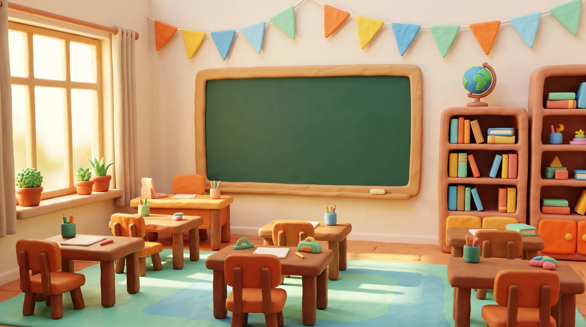

# Amy

**Stuck on a question? Amy explains it step by step.**

Amy is an AI tutor for school students. She teaches one step at a time, asks a quick check after each idea, and marks your working honestly. This repository holds the Amy website: the landing page, a working demo of the student app, and the mascot sheet.



## Run it on your computer

You need [Node.js](https://nodejs.org) 20 or newer and Git.

```bash
git clone https://github.com/memegyanfactory-gif/amy.git
```

```bash
cd amy
```

```bash
npm install
```

```bash
npm run dev
```

Then open http://localhost:5288.

No API keys, accounts or database are needed. Everything, including all the photos, is in this repository.

| Command | What it does |
| --- | --- |
| `npm run dev` | Start the dev server on port 5288 |
| `npm run build` | Type-check and build the finished site to `dist/` |
| `npm run preview` | Serve the built site on port 5289 |

### Good to know

- **npm warning about esbuild.** Newer versions of npm print an `allow-scripts` warning for `esbuild` during install. You can ignore it; the site still runs and builds.
- **The launch film** plays from `amy-tutor.com`, not from this repository, so it only shows when that address is online.
- **The student app is a demo.** Amy's replies, lessons and quizzes are written in advance in the code. Nothing is sent to a server or an AI model.

## Putting it online

`npm run build` makes a plain static site in `dist/`. Upload that folder to any static host, such as Cloudflare Pages, Netlify, Vercel or GitHub Pages. The site uses `#/` addresses, so no server settings are needed.

## Pages

| Address | Page |
| --- | --- |
| `#/` | Landing page |
| `#/app` | Student app demo. `#/app?ask=...` opens it with a question |
| `#/amy` | Mascot sheet: Amy's moods and sizes |

## The landing page

- **Header and footer.** A floating glass header that hides as you scroll down, with a full-screen menu on phones. The footer has link columns, a country picker, the theme switch and a large "Amy" wordmark.
- **Ask box up front.** Type a question on the first screen and it opens Amy with that question. A class picker swaps the example questions for your stage of school.
- **Scroll-driven hero.** As you scroll, the first screen gives way to "If you can wonder it, Amy can teach it." while student and subject photos fly past.
- **She grows up with you.** Four stages of school, each with a student photo and a short sample conversation.
- **The chalkboard.** The four teaching steps as sticky notes you can drag around.
- **Made for everyone.** A gallery of students, teachers and parents whose photos bend with scroll speed.
- **Why it sticks.** An interactive forgetting-curve graph (an illustration, not Amy results).
- **A lesson that plays by itself**, animated feature tiles and the launch film.
- **Subjects**, **curricula** for 16 countries, **for schools**, **pricing** (Amy and Amy+) and an **FAQ** with an ask-Amy box.
- Light and dark themes, and layouts for phone, tablet and desktop.

## The student app demo (`#/app`)

- **First login** asks for name, age, class, subjects, goals and interests.
- **Home** shows where you left off on a chalkboard, your streak, revision cards, today's plan and your next test.
- **Ask Amy** chat: Amy shows her thinking steps, writes word by word and draws as she explains. One chat bar for drawing, photos, PDFs, voice typing and a live voice call. "Read as slides" shows one idea at a time.
- **Lessons** with a course outline, teaching in small parts with a check after each, hints, "explain differently", practice questions, spot Amy's mistake, explain it back, and a 7-question quiz (6 to pass).
- **The board** beside each lesson: slides, an infographic, a mind map and a table, each downloadable as a JPG in light or dark.
- **Courses**, a **calendar** for exams, study plans and to-dos (you can import `.ics` files), **games** for revision, and a **profile** with the Free or Amy+ plan.

Four lessons have full content: Acceleration, Atomic mass, Plant and animal cells, and Word problems. They live in [`src/lessons.ts`](src/lessons.ts).

### What is saved

The demo saves your profile, calendar, lesson progress, chat settings, theme and country in the browser's local storage (keys starting with `amy-`). Nothing leaves the browser. To start over, clear the site data for `localhost` in your browser.

## It adapts to where you study

The page works out the visitor's country in the browser and adjusts itself:

| What changes | India | United States | Nigeria |
| --- | --- | --- | --- |
| Stages | Class 1 to 5, 6 to 8, 9 to 12, NEET | Grades K to 5, 6 to 8, 9 to 12, SAT / ACT | Primary 1 to 6, JSS 1 to 3, WAEC / NECO, JAMB |
| Subject headline | From first sums to NEET | From first sums to the SAT | From first sums to JAMB |
| Wording | Maths | Math | Maths |
| Boards | CBSE, ICSE, ISC, State Board, NIOS | Common Core, AP, SAT / ACT prep | WAEC, NECO, JAMB prep |
| Student photos | South Asia set | Western set | Africa set |

How the country is chosen, in order:

1. `?country=US` in the address (handy for sharing a link or testing).
2. The country the visitor picked last time, saved in the browser.
3. The device time zone, for example `Asia/Kolkata` means India.
4. The browser language, for example `en-GB` means United Kingdom.
5. Otherwise the "International school" version.

There is no location permission prompt. Visitors can change country at any time in the **Curricula** section or the footer, and the whole site, including the student app, follows.

Supported: India, United States, United Kingdom, Australia, Canada, Singapore, Malaysia, Philippines, Pakistan, Bangladesh, Nepal, Sri Lanka, Nigeria, Kenya, South Africa and International school. All of this lives in [`src/region.tsx`](src/region.tsx); add or edit a country there.

To see another country's version locally, open `http://localhost:5288/?country=US` (use any code from `src/region.tsx`, such as `GB`, `NG` or `SG`).

## Project layout

```
public/
  amy-icon.svg       Site icon
  art/               Photos used across the site
src/
  pages/
    Landing.tsx      The landing page, section by section, with its header and footer
    Dashboard.tsx    Student app demo: top bar and tabs
    MascotSheet.tsx  Amy's moods
  components/
    Amy.tsx          Amy the mascot
    LandingBits.tsx  Feature tile animations and the FAQ
    LandingMore.tsx  People gallery and the forgetting curve
    dash/            Student app screens: Home, Chat, Composer, Lesson,
                     Board, Courses, Planner (calendar), Onboarding, Other
  bits/              Reusable animated pieces (logo loop, aurora, tooltips and others)
  lessons.ts         Lesson content: slides, board, practice and quiz
  store.ts           What the demo saves in the browser
  region.tsx         Country detection and per-country content
  theme.tsx          Light and dark theme
  router.ts          Hash router
  index.css          Design tokens and utilities
```

## Built with

React 18, TypeScript, Vite 6, Tailwind CSS 4, Motion and GSAP for animation. Icons are from Hugeicons. Fonts are Geist, Instrument Serif and Caveat, installed from npm, so the site needs no font downloads at runtime.

## Images

The photos in `public/art` were generated with Magnific for this site. The students shown are not real people.
